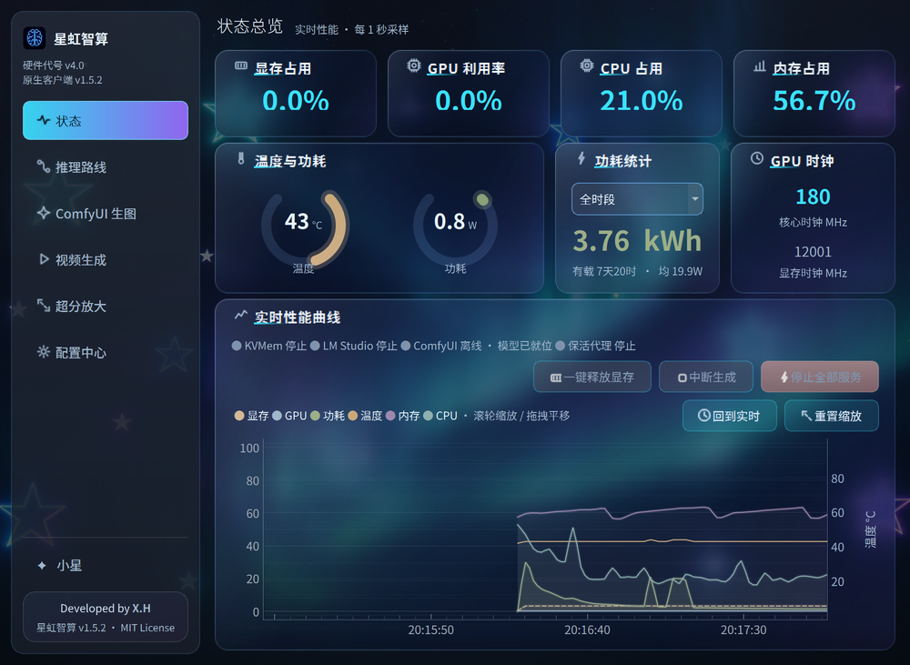
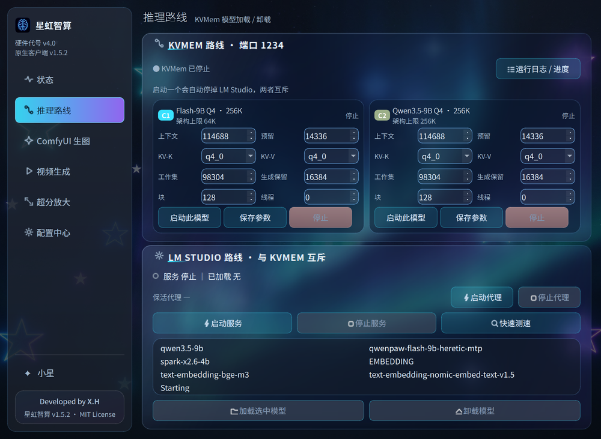
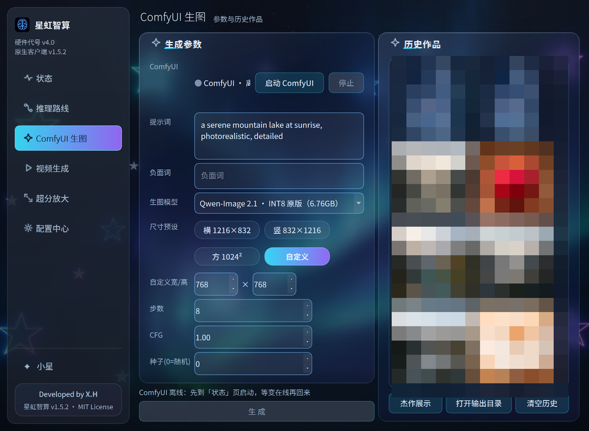
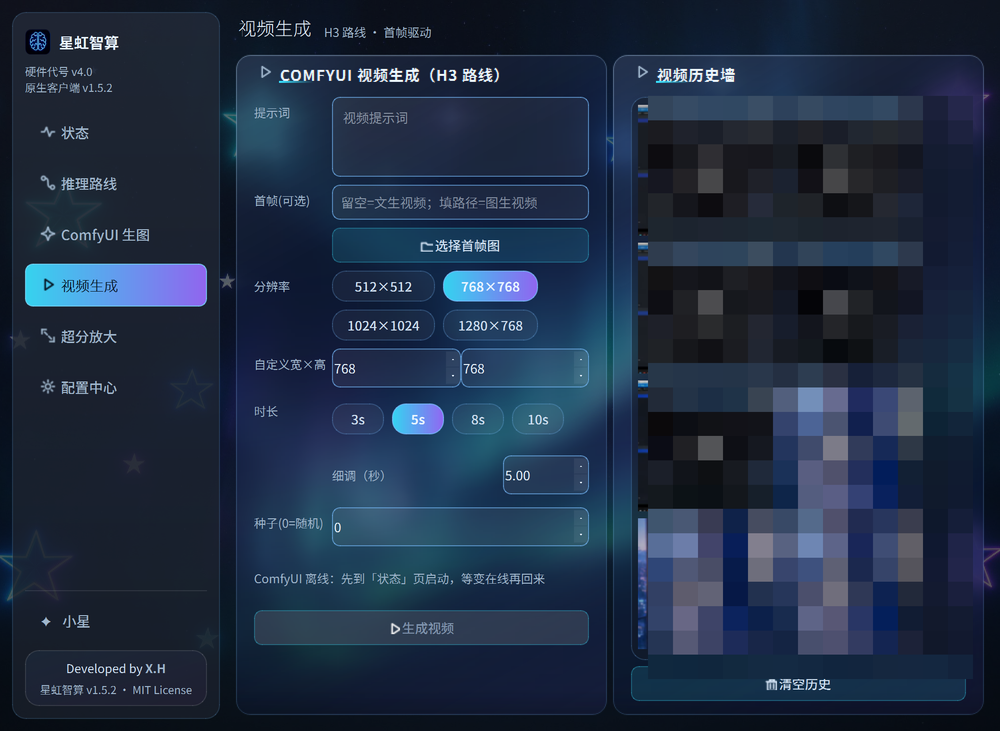
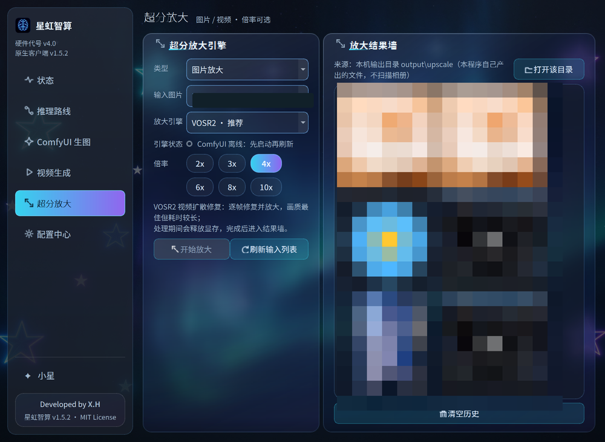
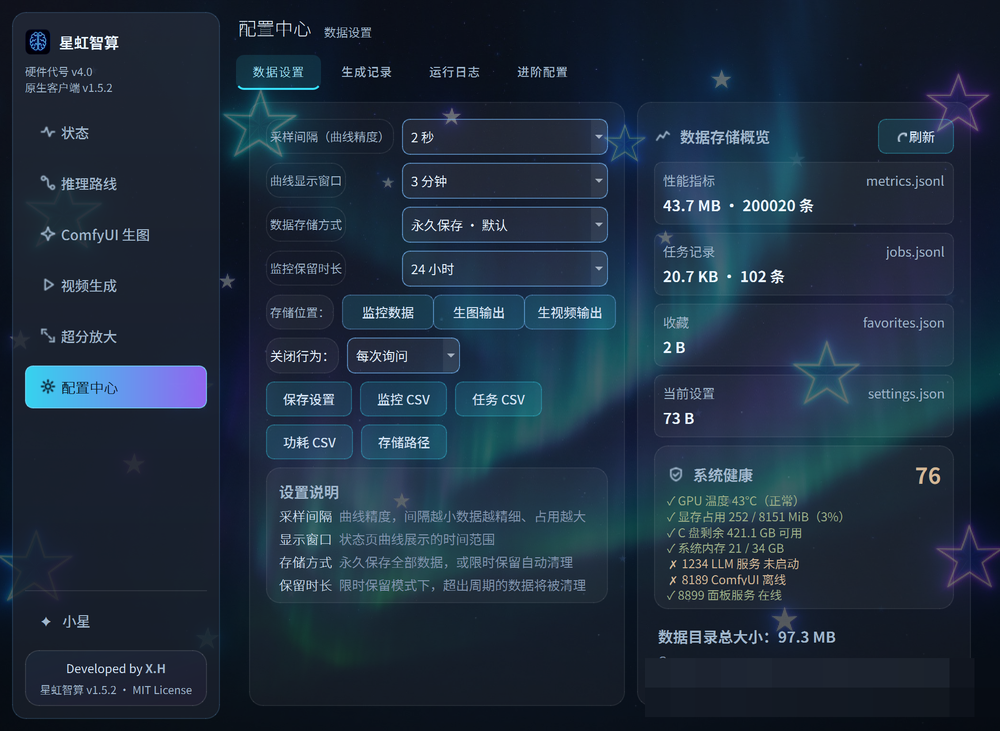
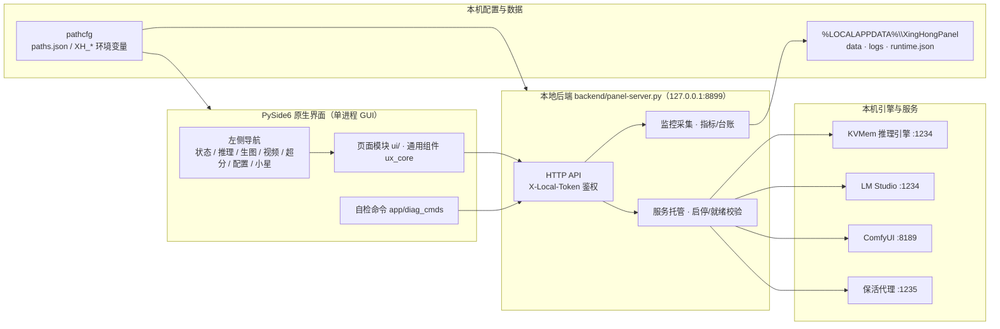

# 星虹智算（XingHong Panel）

**一句话定位**：面向单机 GPU 工作站的本地算力控制台 —— 用一套原生界面管理推理引擎、ComfyUI 生图/生视频/超分、资源监控与任务记录，数据不出本机。

---

## 一、推理与模型接入

内置两条互斥的本地推理路线：KVMem 引擎（`llama-kvmem-server`，长上下文前缀缓存优化）与 LM Studio（`lms.exe`）。面板负责显存/端口抢占检测、启动等待、就绪校验与一键切换，也可直接加载 LM Studio 模型清单。模型档案保存在 `backend/web-profiles.json`，其中的模型路径支持相对路径，基准目录由本机配置决定。

## 二、生图、生视频与超分

托管本地 ComfyUI（默认端口 8189），提供串行任务队列、模型存在性检查、输出墙实时扫描与删除演练。生图/生视频/超分三个页面共用同一套作品墙与首帧播放逻辑，视频首帧优先读本地文件以避开 HTTP Range 限制。

## 三、面板与监控

每 2 秒采样 CPU/GPU/内存/功耗/温度，绘制滚动曲线并给出健康分与建议项。磁盘健康按系统盘统计，存储占用分列数据、日志与输出。所有指标写入本地 `metrics.jsonl`，可设置保留时长或永久保存。

## 四、会话与记录

任务台账记录每次启动/停止/生成的关键字段（耗时、参数、结果路径），配置中心可筛选查看并导出 CSV。作品墙与台账都由后端实时扫描输出目录生成，不依赖额外数据库服务。

## 五、托管与自启

面板以单实例方式运行（命名管道互斥），支持托盘常驻、关闭行为可选（询问/最小化/退出）。托管服务可一键全部停止并释放显存；退出时会按顺序停 KVMem、LM Studio、ComfyUI 与保活代理。程序本身不注册开机自启，是否常驻由用户决定。

## 六、配置与权限

配置中心集中管理采样间隔、保留时长、存储位置、CSV 导出与进阶参数；所有写操作走本地 HTTP 接口并校验一次性 token（`X-Local-Token`）。API Key 等敏感值用 Windows DPAPI 按当前用户加密存储，不落明文。首次启动会展示用户协议、隐私说明与安全提示，需明确同意后才进入主界面。

---

## 架构

界面只与本机回环后端通信；后端通过 `pathcfg` 读取本机路径（KVMem 可执行文件、模型目录、ComfyUI 根与存储、node 与保活代理脚本），仓库内不含任何开发机绝对路径。

## 安装与首次配置

1. 安装版：运行 `星虹智算-<版本>-setup-win64.exe`；便携版：解压后直接运行 `XingHongPanel.exe`。
2. 首次启动阅读并同意用户协议 / 隐私说明。
3. 打开「配置中心 → 进阶配置」，按本机实际情况设置模型目录、KVMem 可执行文件、ComfyUI 安装目录与存储目录（见 [安装与配置](docs/安装与配置.md)）。
4. 在「推理路线」选择 KVMem 或 LM Studio 并启动；需要生图时在「ComfyUI 生图」页启动 ComfyUI。
5. 全部路径都有默认值与回落逻辑，未配置时界面可正常打开，只是对应功能不可用。

## 数据存放位置

| 内容 | 位置 |
|---|---|
| 指标 / 台账 / 设置 / ComfyUI 数据库 | `%LOCALAPPDATA%\XingHongPanel\data`、`logs` |
| 运行态 token | `%LOCALAPPDATA%\XingHongPanel\runtime.json`（每次启动重写） |
| 本机路径配置（可选） | `%LOCALAPPDATA%\XingHongPanel\paths.json` |
| 模型与输出 | 由本机路径配置指向，默认不随软件目录存放 |

## 截图口径

本文档所有截图均在应用**默认打开尺寸 1000×731** 下用真实窗口抓取（200% DPI 抓取后按 DPR 降采样到 1000×731），未拼接、未放大。窗口允许拖到最小 980×640；该尺寸下推理页模型列表最后一行会贴边裁切，属已知缺陷，处理计划见 [FAQ](docs/FAQ.md#为什么窗口拖到最小尺寸时推理页列表最后一行被裁切)。

## 版本记录

| 版本 | 要点 |
|---|---|
| 1.5.2 | 启动耗时告警与面板自检收口；路径改为本机配置驱动，仓库不含开发机绝对路径 |
| 1.5.0 | QSettings 键统一、安装包许可清单补全、托盘菜单修复 |
| 1.4.3 | 生图页启停按钮 NameError 修复；超分输入限幅 |
| 1.4.0 | ComfyUI 托管、作品墙与任务台账 |

完整记录见 [CHANGELOG](docs/CHANGELOG.md)。

## 许可证

本项目以 **MIT** 许可发布，见 [LICENSE](LICENSE)。随包分发的第三方组件（PySide6/Qt、NumPy、psutil、pyqtgraph、Noto Sans SC 等）及其许可证见 [THIRD_PARTY_NOTICES](docs/THIRD_PARTY_NOTICES.md)。
