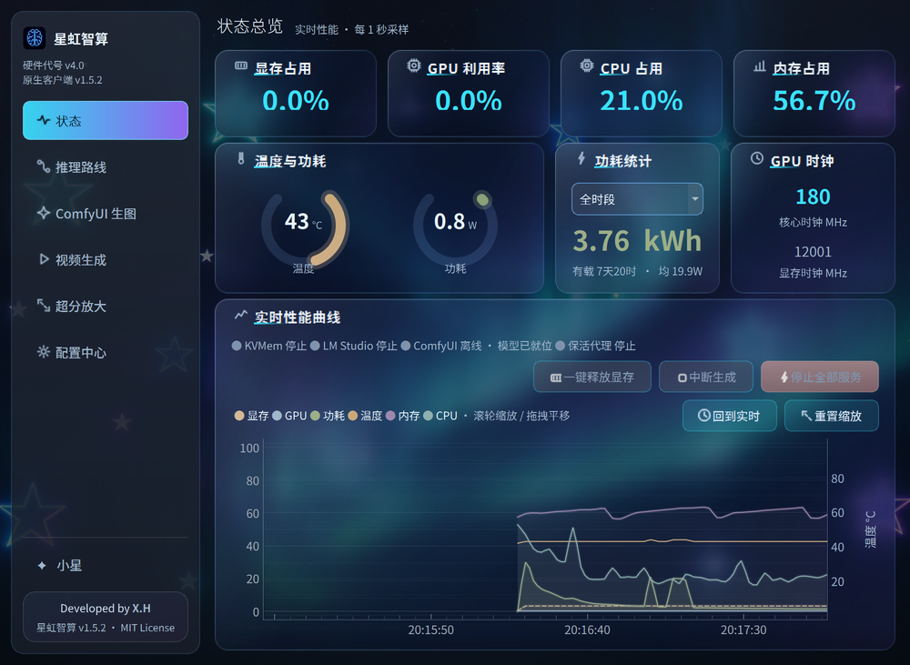
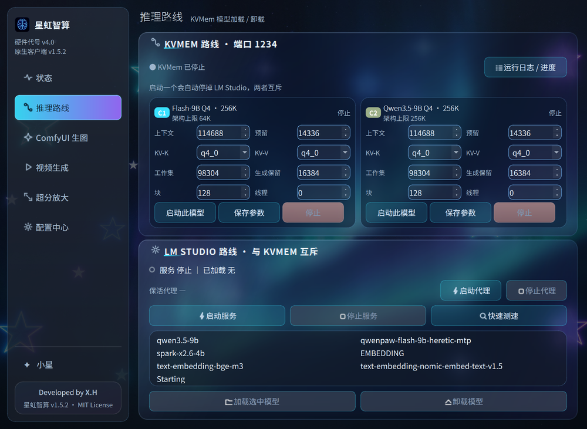
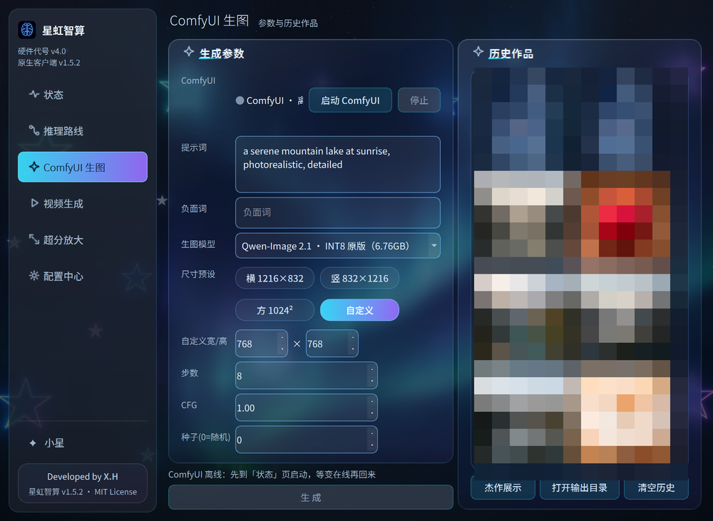
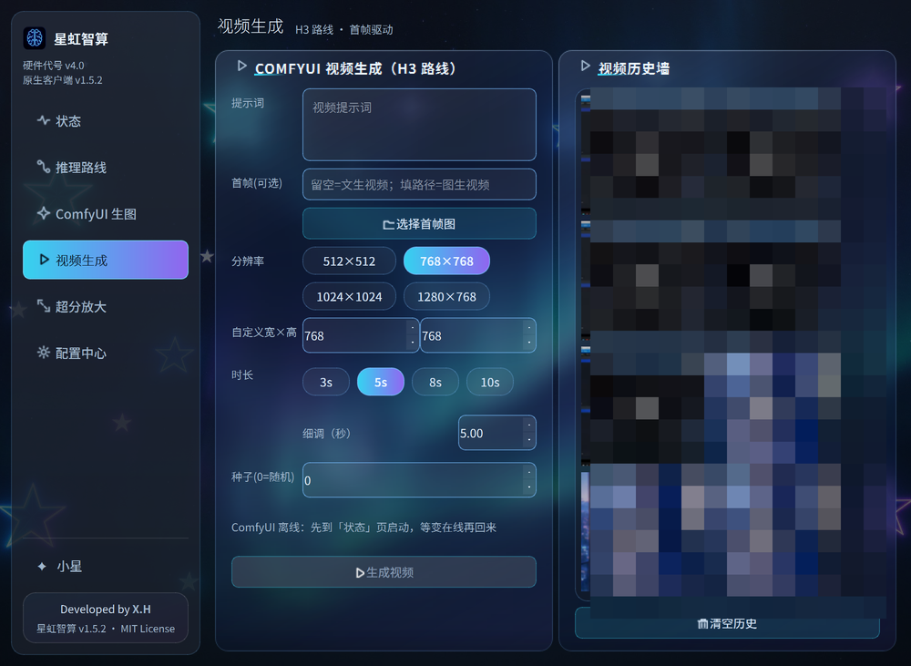
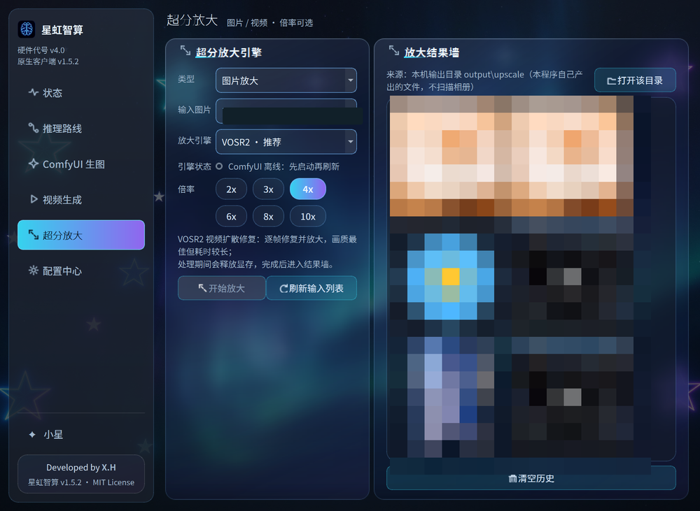
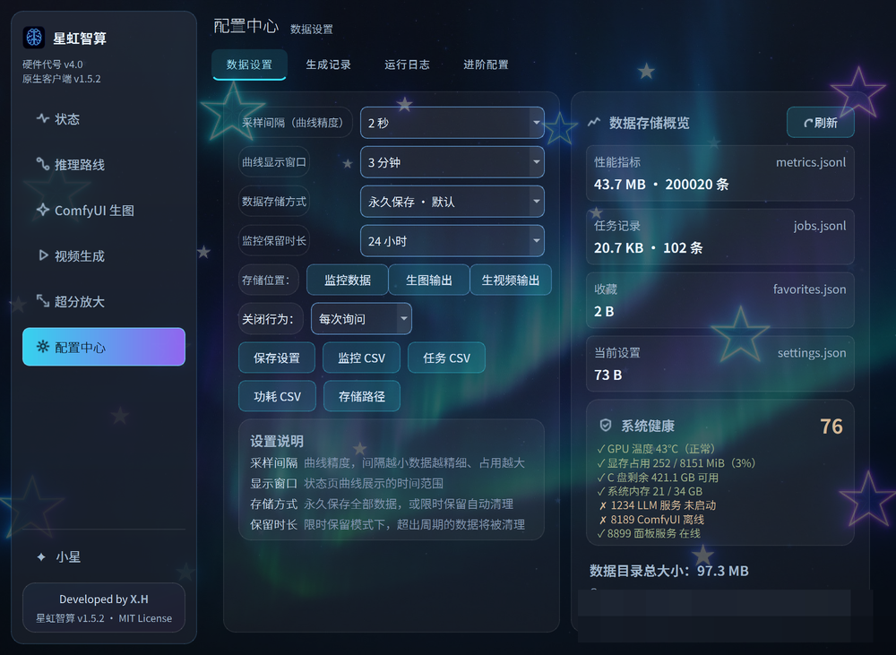
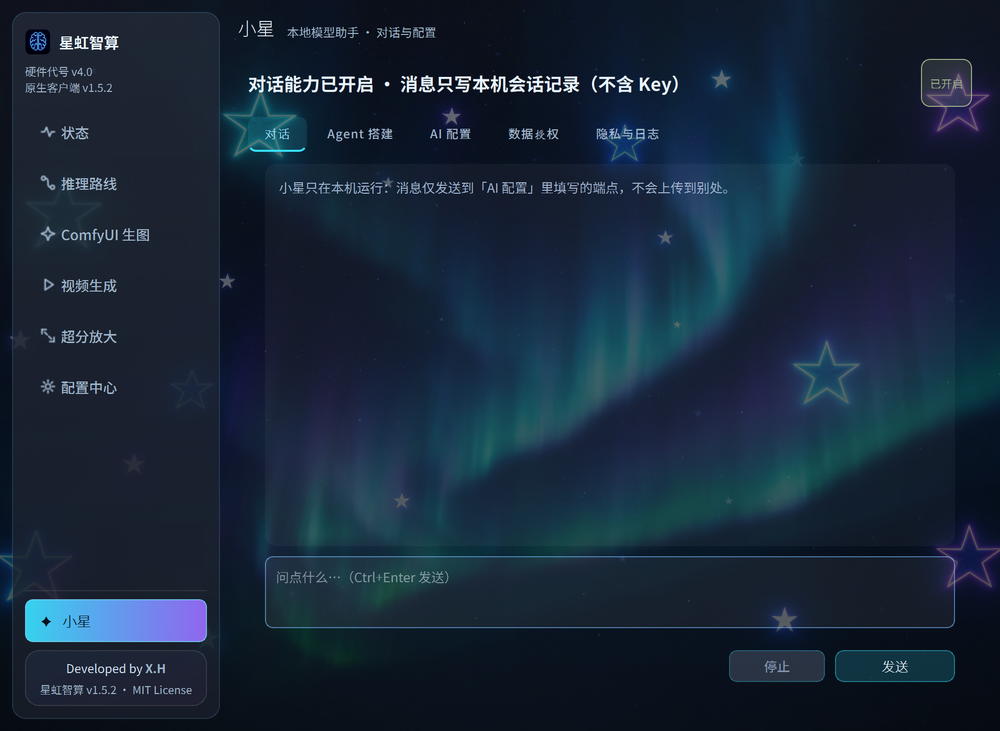

# 功能说明

本文按界面导航顺序说明各页面能力、状态来源与边界条件。截图均为默认窗口尺寸 1000×731 下的实窗截图。

## 1. 状态总览

- 顶部四块大数字：CPU、GPU、内存、显存；下方为功耗/温度小卡与滚动曲线。
- 健康检测返回 0–100 分与逐项状态（GPU 温度、显存占用、系统盘剩余、内存、1234/8189/8899 端口）。
- 存储占用分列「数据 / 日志 / 输出」，每天定时统计，避免频繁遍历大目录。
- 「停止全部」一次性停 KVMem、LM Studio、ComfyUI 与保活代理并释放显存，用于切换任务前清场。

## 2. 推理路线

- 两条互斥路线：KVMem（自带长上下文前缀缓存）与 LM Studio；同一时间只允许一条占用 1234 端口。
- 每个档案显示模型是否存在于本机、上下文长度、KV 预算与推荐的 KV 精度档位。
- 启动前会检查端口占用、引擎残留与显存是否释放；启动后等待模型别名在 `/v1/models` 中就绪，再置为「运行中」。
- 模型路径支持相对路径：`root=models_dir` 相对模型根目录，`root=models_flash` 相对 Flash 模型目录。

## 3. ComfyUI 生图

- 托管本机 ComfyUI：启动时传入端口、模型路径配置、输入/输出目录与独立 sqlite 库。
- 生成任务串行执行，界面显示阶段与进度；模型缺失会在提交前拦截。
- 作品墙实时扫描输出目录，支持缩略图、原图预览、双击打开与删除（删除有二次确认与路径校验）。

## 4. 视频生成

- 与生图共用 ComfyUI 服务与输出目录（`output/video`），作品墙按视频类型过滤。
- 首帧优先读本机文件，避免 HTTP 静态服务对 Range 支持不足导致 ffmpeg 判定为 partial file。
- 超过阈值的视频不整段解码，改为占位封面，防止缩略图线程被大文件拖死。

## 5. 超分放大

- 支持 ESRGAN 与扩散类放大两条路线；ESRGAN 固定 4×，扩散类按所选倍率执行。
- 扩散放大前按显存预算限幅：输出超过 16MP 时自动生成等比缩小的输入副本并提示。
- 结果墙与生图同构，可打开结果目录、预览与删除。

## 6. 配置中心

- 数据设置：采样间隔、曲线窗口、存储方式（永久/限时）、保留时长，以及数据/输出目录的「打开目录」按钮。
- 生成记录：任务台账表格，可按时间与状态筛选、导出 CSV。
- 运行日志：面板日志与后端日志查看。
- 进阶配置：模型目录、KVMem 可执行文件、ComfyUI 根与存储、node 与保活代理脚本等本机路径；API Key 等敏感值用 DPAPI 加密。

## 7. 小星

- 内置的对话/工具入口，读取同一套模型与路线配置，不额外起服务。
- 无模型运行时给出明确提示，不会静默失败。

## 8. 通用行为

- 单实例：重复启动会激活已有窗口后退出，避免重复 GUI 与端口冲突。
- 托盘常驻：关闭行为可选「每次询问 / 最小化到托盘 / 退出应用」。
- 退出顺序：先停托管服务，再退代理与后端，最后退出界面；强制退出有超时兜底。
- 程序不注册开机自启与计划任务，也不会在后台自拉起。
