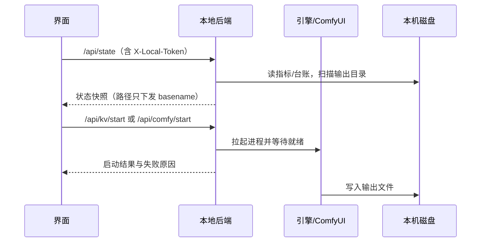

# 架构说明

## 1. 进程与端口

| 进程/服务 | 说明 | 端口 |
|---|---|---|
| `XingHongPanel.exe`（PySide6 GUI） | 唯一界面进程，单实例命名管道互斥 | — |
| `backend/panel-server.py` | 本地后端，由 GUI 拉起，只绑回环地址 | 8899 |
| KVMem 引擎 / LM Studio | 二选一的推理服务 | 1234 |
| 保活代理（node） | KVMem 空闲时重放请求维持前缀缓存 | 1235 |
| ComfyUI | 生图/生视频/超分后端 | 8189 |

GUI 与后端之间只走 `http://127.0.0.1:8899`，请求附加 `X-Local-Token`；token 每次启动重新生成并写入 `%LOCALAPPDATA%\XingHongPanel\runtime.json`。

## 2. 代码分层

```
xinghong_launcher.py     入口：QApplication、主窗口、导航、页面装配、服务自检
ux_core.py               主题令牌、控件基类、Prefs/SecretStore、通用绘制
ui/pages_*.py            七个页面（status / reasoning / gen / video / upscale / config / xiaoxing）
app/                     tray、shutdown、xx_workers、diag_cmds 等应用层模块
backend/panel-server.py  本地后端：HTTP API、监控采集、服务托管、ComfyUI 调度
infra/config.py          功能开关与环境变量读取
pathcfg.py               本机路径配置解析（无绝对路径）
legal/                   用户协议、隐私说明、安全提示、第三方许可
installer/               Inno Setup 脚本与中文语言文件
```

分层约束：`ui/` 只依赖 PySide6、标准库与 `ux_core`，不反向 import launcher；launcher 需要注入的控件工厂、主题令牌与状态快照一律显式传参。

## 3. 本机路径配置

`pathcfg.py` 统一解析本机路径，优先级：

1. 环境变量 `XH_<KEY>`（如 `XH_COMFY_STORE`）；
2. `%LOCALAPPDATA%\XingHongPanel\paths.json`；
3. 中性默认值（一般落在 `%LOCALAPPDATA%\XingHongPanel` 下，或留空表示该功能未配置）。

后端以独立脚本运行，`panel-server.py` 启动时把仓库根加入 `sys.path` 再 `import pathcfg`；打包后 `pathcfg.py` 随包分发在 `_internal` 根目录。

## 4. 数据流



后端对模型路径做脱敏：状态接口只返回文件名与是否存在，不下发绝对路径。

## 5. 监控与持久化

- 采样线程每 2 秒采集一次，指标写 `data/metrics.jsonl`，能量明细写 `data/energy.jsonl`。
- 台账写 `data/jobs.jsonl`，由前端轮询渲染；数据量有硬上限，避免无界增长。
- 设置写 `data/settings.json`，仅接受白名单字段，非法值直接 400 且不落盘。
- ComfyUI 使用独立的 sqlite 数据库文件，不与软件配置混用。

## 6. 构建

`build_xinghong.py` 从 `ux_core.py` 的版本号/产品名生成 `version.txt`、`product_name.txt`、`version_info_xinghong.txt` 与安装器 `_name.iss`，再调用 `XingHongPanel.spec` 做 PyInstaller 打包。spec 只从仓库内 `backend/`、`assets/`、`legal/` 取文件，可从本仓库完整重建。安装包由 `installer/xinghong_setup.iss` 生成。
